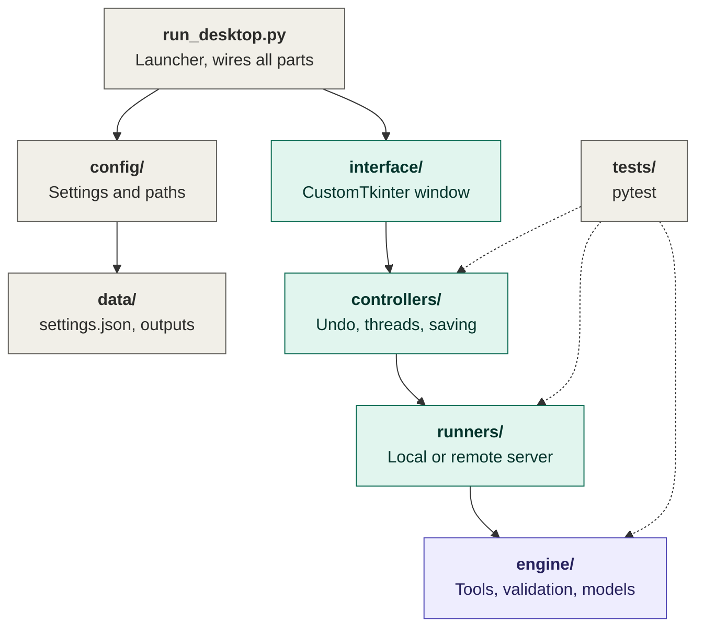
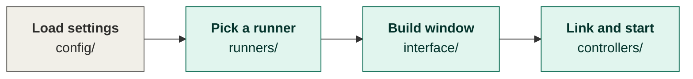
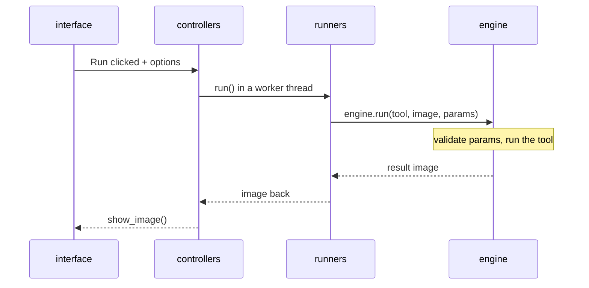

# Image AI Studio: Desktop App

A desktop image-editing app built with **CustomTkinter**, powered by a shared Python **image engine**. The engine is also the core that the FastAPI backend and the PWA use, so every tool is written once and works in both versions.

> **Status:** early development. The engine, runners, controller and interface are in place with two working tools. See [Status and roadmap](#status-and-roadmap).

---

## Contents

- [Features](#features)
- [Architecture](#architecture)
- [Project structure](#project-structure)
- [Getting started](#getting-started)
- [Configuration](#configuration)
- [Tools](#tools)
- [Adding a new tool](#adding-a-new-tool)
- [Local and remote mode](#local-and-remote-mode)
- [Testing](#testing)
- [Status and roadmap](#status-and-roadmap)

---

## Features

- **Tool sidebar built automatically.** Every tool found in `engine/tools/` appears in the sidebar with its own options.
- **Options generated from the tool.** Sliders, dropdowns and switches are built from each tool's parameter list, so a new tool needs no UI code.
- **Responsive UI.** Processing runs on a worker thread; the window never freezes.
- **Undo, Original and Save.** Up to 20 undo steps, one-click return to the original image, PNG/JPEG/WebP export.
- **Local or remote processing.** Run the engine on your machine, or send images to the backend, with no UI changes.
- **Isolated tool failures.** A tool that fails to import is skipped and reported; the app still starts.

Keyboard shortcuts: `Ctrl+O` open, `Ctrl+S` save, `Ctrl+Z` undo.

---

## Architecture

The core rule: **`engine/` knows nothing about windows, HTTP or runners.** Every other layer depends on it, never the reverse.

### Folder map

Solid arrows mean "calls or uses". Dashed arrows mean "tests check".



| Folder | Role | Must not |
|---|---|---|
| `run_desktop.py` | Loads settings, picks a runner, builds the window and controller, starts the event loop | contain logic |
| `config/` | Settings (`settings.json` plus environment overrides) and file paths | import engine internals |
| `data/` | Runtime files: `settings.json`, `outputs/`, `cache/` (git-ignored) | hold source code |
| `interface/` | CustomTkinter widgets: window, sidebar, workspace, canvas, options panel | call the engine directly |
| `controllers/` | Holds the current image and undo history; runs tools on a worker thread | touch widgets from a thread |
| `runners/` | The only thing the UI uses to process images: `LocalRunner` or `RemoteRunner` | know about widgets |
| `engine/` | Tool registry, validation, model loading, image I/O, pipelines | import UI or HTTP code |
| `tests/` | pytest suites for the engine, runners and controller | |

### Startup (runs once)



### What happens on each click of Run



1. The workspace collects the option values and the controller starts a worker thread.
2. The worker calls `runner.run(tool, image, params)`.
3. `LocalRunner` calls `Engine.run(...)` in-process. `RemoteRunner` sends the image to the backend, which calls the same `Engine.run(...)`.
4. The engine finds the tool, fills defaults, clamps values, rejects unknown options, then runs the tool and returns a **new** image.
5. The result is placed in a queue. The UI thread polls that queue, shows the image and pushes the previous one onto the undo stack.

---

## Project structure

```
DesktopApp/
├── run_desktop.py                 # launcher
├── pyproject.toml                 # makes `engine` installable (used by the backend)
├── requirements.txt
├── ARCHITECTURE.md                # extended architecture notes
│
├── config/
│   ├── settings.py                # load/save settings, environment overrides
│   └── paths.py                   # data folder locations
│
├── data/                          # runtime files (git-ignored)
│   ├── outputs/
│   └── cache/
│
├── engine/                        # shared core, no UI code
│   ├── engine.py                  # Engine.run / list_tools / describe_tools
│   ├── base_tool.py               # BaseTool contract + ToolContext
│   ├── tool_registry.py           # auto-discovers engine/tools/*/tool.py
│   ├── pipeline.py                # chain several tools
│   ├── model_manager.py           # lazy-loads and caches models
│   ├── device_manager.py          # cuda / mps / cpu
│   ├── image_loader.py            # disk/bytes -> PIL (EXIF-aware)
│   ├── image_exporter.py          # PIL -> disk/bytes
│   ├── errors.py
│   ├── schemas/                   # ParamSpec, ToolInfo, validate_params
│   ├── tools/
│   │   ├── blur/
│   │   └── auto_enhance/
│   └── models/
│       ├── manifest.json          # model registry
│       ├── adapters/              # one wrapper per model family
│       └── weights/               # downloaded weights (git-ignored)
│
├── runners/
│   ├── base_runner.py             # interface the UI depends on
│   ├── local_runner.py            # calls the engine in-process
│   └── remote_runner.py           # calls the FastAPI backend over HTTP
│
├── controllers/
│   └── editor_controller.py       # image, undo history, worker thread
│
├── interface/
│   ├── main_window.py             # root window, dialogs, shortcuts
│   ├── workspace.py               # toolbar, canvas, options and Run button
│   ├── sidebar.py                 # tool list
│   ├── canvas.py                  # image preview
│   └── components/
│       └── params_panel.py        # controls built from tool options
│
└── tests/
    ├── test_engine.py
    └── test_controller.py
```

---

## Getting started

**Requirements:** Python 3.10 or newer, with Tk support. On Debian/Ubuntu, install it with `sudo apt install python3-tk`. The Python installers for Windows and macOS include Tk.

```bash
# from the DesktopApp/ folder
python -m venv .venv
source .venv/bin/activate          # Windows: .venv\Scripts\activate
pip install -r requirements.txt

python run_desktop.py
```

Run it from inside `DesktopApp/` so the `engine`, `interface` and other packages can be imported.

`mediapipe` is only needed for Blur's *background* mode. The `requests` package is only needed for [remote mode](#local-and-remote-mode).

---

## Configuration

Settings live in `data/settings.json` and can be overridden with environment variables.

| Setting | Environment variable | Default | Description |
|---|---|---|---|
| `mode` | `IMAGE_STUDIO_MODE` | `local` | `local` or `remote` |
| `server_url` | `IMAGE_STUDIO_SERVER` | `http://127.0.0.1:8000` | Backend address (remote mode) |
| `token` | `IMAGE_STUDIO_TOKEN` | empty | Bearer token (remote mode) |
| `appearance` | none | `dark` | `dark`, `light` or `system` |

```json
{
  "mode": "local",
  "appearance": "dark"
}
```

---

## Tools

| Tool | Options | Notes |
|---|---|---|
| **Blur** | `mode` (whole / background), `strength` (1-50) | Background mode keeps the person sharp. It needs `mediapipe`; a small model file is downloaded on first use. |
| **Auto Enhance** | `contrast_cutoff`, `color`, `sharpness` | Automatic contrast, then color and sharpness. Keeps the alpha channel. |
| **Crop** | `aspect`, `zoom`, `offset_x`, `offset_y` | Crop to a ratio, zoom in, and move the crop window. |
| **Rotate / Flip** | `turn`, `straighten`, `flip_h`, `flip_v` | 90-degree turns, fine straightening, mirroring. |
| **Adjust** | `brightness`, `contrast`, `saturation`, `warmth` | Manual color controls. |
| **Text Watermark** | `text`, `color`, `size`, `opacity`, `position` | Stamps a line of text. |
| **Face Blur** | `sensitivity` (Strict / Balanced / Sensitive), `strength`, `padding` | Detects faces with YuNet and blurs them. Needs `opencv-python` (4.x); the small detector model downloads on first use. |

Planned tools: background removal, object removal, inpainting, outpainting, upscaling, colorization, relighting, style transfer, image to PDF, image to text.

---

## Adding a new tool

Adding a tool means adding one folder. The registry finds it, the sidebar shows it, the options panel builds itself, and the backend can expose it.

1. Create `engine/tools/<name>/` with an empty `__init__.py` and a `tool.py`:

   ```python
   from PIL import Image, ImageOps

   from engine.base_tool import BaseTool, ToolContext
   from engine.schemas.requests import ParamSpec


   class MirrorTool(BaseTool):
       name = "mirror"
       label = "Mirror"
       description = "Flip the image left to right."
       params = [
           ParamSpec("enabled", "Flip", "bool", True),
       ]

       def run(self, image: Image.Image, params, ctx: ToolContext) -> Image.Image:
           return ImageOps.mirror(image) if params["enabled"] else image.copy()
   ```

2. If the tool needs a model, add an entry to `engine/models/manifest.json`, write an adapter in `engine/models/adapters/<model>.py` (a class named `Adapter`), and call `ctx.models.get("<model>")` inside `run()`.

**Rules for tools:**
- Always return a **new** image. Never modify the input.
- `params` arrives already validated and with every key filled in.
- Import model libraries only inside adapters, never in `tool.py`.

Supported option kinds for `ParamSpec`: `slider`, `int`, `choice`, `bool`, `text`, `color`. Each one appears as a control in the options panel at the bottom of the window (two columns when a tool has more than three options), and **Reset options** puts them all back to their defaults.

---

## Local and remote mode

The UI only talks to a runner, so switching mode is a setting, not a code change.

| | `LocalRunner` | `RemoteRunner` |
|---|---|---|
| Where processing happens | This computer | The FastAPI backend |
| Works offline | Yes | No |
| Uses the same tools | Yes | Yes (the backend calls the same `engine.run`) |

Endpoints that `RemoteRunner` expects from the backend:

| Method | Path | Request | Response |
|---|---|---|---|
| `GET` | `/api/tools` | none | list of tool descriptions (`ToolInfo`) |
| `POST` | `/api/tools/{name}` | multipart: `file` (image), `params` (JSON string) | PNG bytes, or `{"detail": "message"}` with a 4xx/5xx status |

Authentication uses the header `Authorization: Bearer <token>` when a token is set.

**Using the engine from the backend:** from the repository root, run `pip install -e DesktopApp`, then `from engine.engine import run` in `backend/`.

---

## Testing

```bash
pytest
```

The suites cover tool discovery, parameter validation, tool behavior, pipelines, the runners, and the controller (undo, reset, error handling, saving) using a fake view, so no display is needed.

---

## Status and roadmap

| Area | State |
|---|---|
| Engine core, registry, validation, pipeline, model manager | Working, tested |
| Tools: Blur (whole image), Auto Enhance | Working, tested |
| Tool: Blur (background mode) | Written, not yet run end-to-end |
| Controller (threading, undo, reset, save) | Working, tested with a fake view |
| CustomTkinter window | Written, not yet launched on a real display |
| `RemoteRunner` | Written, waiting for the backend |
| Remaining tools, FastAPI backend, React PWA | Not started |

**Next steps:** run the app on a real display and fix any visual issues, add the lightweight tools (cropping, face blur, image to PDF), then build the FastAPI backend with `GET /api/tools` and `POST /api/tools/{name}`.
