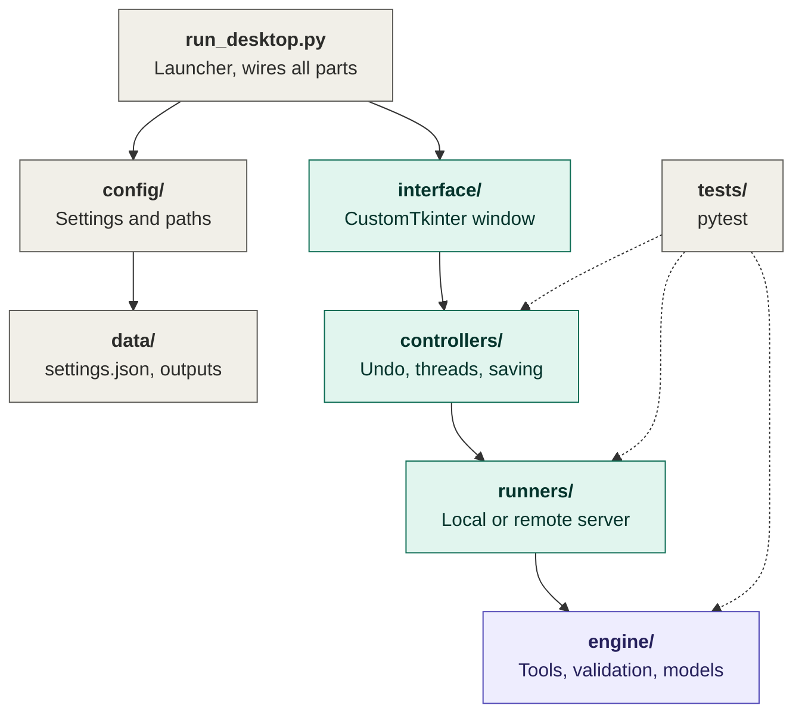
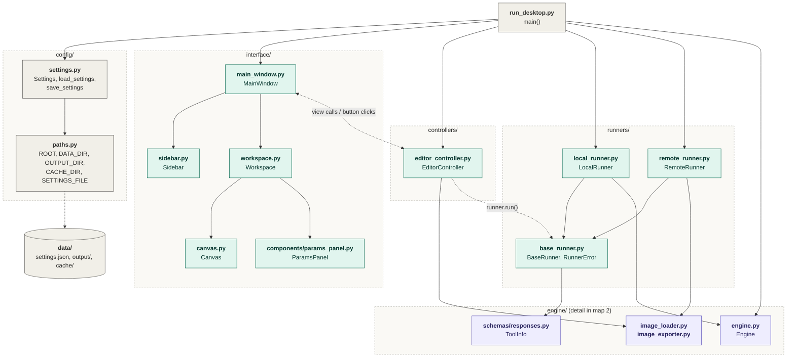
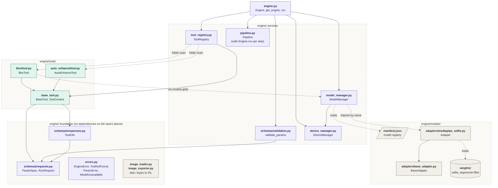

# Folder map

Every folder and every `.py` file of `DesktopApp/`, what each module contains, and who imports whom.

**Rule of the whole map:** `engine/` knows nothing about windows, HTTP or runners. Every other layer depends on it, never the reverse.

**How to read the diagrams**

| Symbol | Meaning |
|---|---|
| Solid arrow `A --> B` | `A` imports or directly calls `B` |
| Dotted arrow `A -.-> B` | linked at runtime: by name, by folder scan, or through an object that is passed in |
| Green boxes | desktop layers (`interface/`, `controllers/`, `runners/`) and tools |
| Purple boxes | the shared engine |
| Gray boxes | support files, data and models |

**Contents**

1. [Overview: the folders](#1-overview-the-folders)
2. [File map: desktop layers](#2-file-map-desktop-layers)
3. [File map: the engine](#3-file-map-the-engine)
4. [File reference: every `.py` file and its modules](#4-file-reference-every-py-file-and-its-modules)
5. [Other files](#5-other-files)

---

## 1. Overview: the folders

Solid arrows mean "calls or uses". Dashed arrows mean "tests check".

| Folder | Role | Must not |
|---|---|---|
| `run_desktop.py` | Loads settings, picks a runner, builds the window and controller, starts the event loop | contain logic |
| `config/` | Settings (`settings.json` plus environment overrides) and file paths | import engine internals |
| `data/` | Runtime files: `settings.json`, output images, cache (git-ignored) | hold source code |
| `interface/` | CustomTkinter widgets: window, sidebar, workspace, canvas, options panel | call the engine directly |
| `controllers/` | Holds the current image and undo history; runs tools on a worker thread | touch widgets from a thread |
| `runners/` | The only thing the UI uses to process images: `LocalRunner` or `RemoteRunner` | know about widgets |
| `engine/` | Tool registry, validation, model loading, image I/O, pipelines | import UI or HTTP code |
| `tests/` | pytest suites for the engine, runners and controller | |

---

## 2. File map: desktop layers

Every `.py` file outside the engine. The `engine/` box at the bottom shows only the three engine files these layers touch; the engine itself is drawn in section 3.

What the arrows mean in practice:

- `run_desktop.py` creates everything and links the window to the controller (`bind_controller`). After `mainloop()` starts it does nothing more.
- `interface/` never imports from `engine/`. It receives tool descriptions (`ToolInfo` objects) as plain data, so it cannot call the engine.
- The controller and the window talk through a small view API (`show_image`, `set_busy`, `set_can_undo`, `set_status`, `show_error`), shown as the two-way dotted arrow.
- The controller never knows whether it holds a `LocalRunner` or a `RemoteRunner`; both follow `BaseRunner`.

---

## 3. File map: the engine

Every `.py` file inside `engine/`, in layers: `engine.py` at the top, services below it, then the tools, models and the foundation that everything else builds on.

What the arrows mean in practice:

- `engine.py` is the only door in. It builds the registry, `ModelManager` and `DeviceManager` once, and `run()` validates parameters before it calls a tool.
- `tool_registry.py` finds tools by scanning `engine/tools/*/tool.py` (dotted "folder scan"). A new tool folder needs no change anywhere else.
- A tool reaches a model only through `ctx.models.get(name)`. `model_manager.py` reads `manifest.json`, imports the adapter named there, and caches it.
- `errors.py` is raised across the whole engine (`engine.py`, `model_manager.py`, `validation.py`, `tool_registry.py`, `mediapipe_selfie.py`) and caught by `runners/`, so its arrows are left out to keep the map readable.
- `image_loader.py` and `image_exporter.py` are standalone helpers; the controller and `RemoteRunner` import them.

---

## 4. File reference: every `.py` file and its modules

Columns: **Modules** are the classes, functions and constants defined in the file. **Imports** lists only project files. **Used by** lists who imports the file.

### 4.1 Entry point

| File | Modules | Imports | Used by |
|---|---|---|---|
| `run_desktop.py` | `main()`: loads settings, picks `LocalRunner` or `RemoteRunner`, builds `MainWindow`, creates `EditorController`, calls `bind_controller`, runs `mainloop()`, then `runner.close()` | `config/settings`, `controllers/editor_controller`, `engine/engine`, `interface/main_window`, `runners/local_runner`, `runners/remote_runner` | nothing (run it directly) |

### 4.2 `config/`

| File | Modules | Imports | Used by |
|---|---|---|---|
| `__init__.py` | package marker | none | none |
| `paths.py` | constants `ROOT`, `DATA_DIR`, `OUTPUT_DIR`, `CACHE_DIR`, `SETTINGS_FILE` | none | `config/settings` |
| `settings.py` | `Settings` (dataclass: `mode`, `server_url`, `token`, `appearance`), `load_settings()` (reads `settings.json`, then `IMAGE_STUDIO_MODE`, `IMAGE_STUDIO_SERVER`, `IMAGE_STUDIO_TOKEN`), `save_settings()` | `config/paths` | `run_desktop` |

### 4.3 `interface/`

| File | Modules | Imports | Used by |
|---|---|---|---|
| `__init__.py` | package marker | none | none |
| `main_window.py` | `MainWindow` (the root window). Lays out sidebar, workspace and status bar. User actions: `select_tool`, `_ask_open`, `_ask_save`, `_run`. View API for the controller: `show_image`, `set_busy`, `set_can_undo`, `set_status`, `show_error`. Also `bind_controller`, shortcuts Ctrl+O / Ctrl+S / Ctrl+Z, constant `IMAGE_TYPES` | `interface/sidebar`, `interface/workspace` | `run_desktop` |
| `workspace.py` | `Workspace`: toolbar (Open, Save, Undo, Original), tool title, canvas, and the bottom panel with the description, the options panel, **Run** and **Reset options**. Methods: `show_tool`, `show_image`, `set_run_enabled`, `set_can_undo`, `_run_clicked` | `interface/canvas`, `interface/components/params_panel` | `interface/main_window` |
| `sidebar.py` | `Sidebar`: one button per tool, built from the tool list; `select(name)` highlights it and reports the tool `name`. Constant `SELECTED` | none | `interface/main_window` |
| `canvas.py` | `Canvas`: `show(image)` scales the image to fit and re-fits after a resize (80 ms debounce). Private `_on_resize`, `_render`. Constant `PADDING` | none | `interface/workspace` |
| `components/__init__.py` | package marker | none | none |
| `components/params_panel.py` | `ParamsPanel`: builds the bottom controls from a tool's option list (`slider`, `int`, `choice`, `bool`, `text`, `color`; two columns above three options). Methods: `show(info)`, `values()`, `reset()`, `_build_control`, `_fmt`. Helper `_text_on(hex)` picks readable text for a color button | none | `interface/workspace` |

### 4.4 `controllers/`

| File | Modules | Imports | Used by |
|---|---|---|---|
| `__init__.py` | package marker | none | none |
| `editor_controller.py` | `EditorController`: holds the current image, the original, and up to 20 undo steps. Methods: `open_image`, `save_image`, `run_tool` (starts a worker thread), `_poll` (UI thread reads the result queue every 50 ms), `undo`, `reset`. Constants `HISTORY_LIMIT = 20`, `POLL_MS = 50` | `engine/image_loader`, `engine/image_exporter` | `run_desktop`, `tests/test_controller` |

### 4.5 `runners/`

| File | Modules | Imports | Used by |
|---|---|---|---|
| `__init__.py` | package marker | none | none |
| `base_runner.py` | `RunnerError`; `BaseRunner` (abstract `describe_tools`, `run`; provided `list_tools`, `close`). The only processing API the UI knows | `engine/schemas/responses` | `local_runner`, `remote_runner`, `tests/test_engine` |
| `local_runner.py` | `LocalRunner(engine)`: calls `Engine.run()` in-process; turns `EngineError` into `RunnerError`; `close()` unloads models | `engine/engine`, `engine/errors`, `engine/schemas/responses`, `runners/base_runner` | `run_desktop`, `tests` |
| `remote_runner.py` | `RemoteRunner(server_url, token, timeout)`: `describe_tools` (GET `/api/tools`), `run` (POST `/api/tools/{name}`, multipart image + JSON params, Bearer token); helpers `_headers`, `_requests`, `_error_text` | `engine/image_exporter`, `engine/image_loader`, `engine/schemas/responses`, `runners/base_runner` | `run_desktop` |

### 4.6 `engine/` core

| File | Modules | Imports | Used by |
|---|---|---|---|
| `__init__.py` | package marker | none | none |
| `engine.py` | `Engine(weights_dir, device)` with `list_tools`, `describe_tools`, `run`, `pipeline`; module-level `get_engine()` and `run()` shortcuts (the backend will use these) | `base_tool`, `device_manager`, `errors`, `model_manager`, `pipeline`, `schemas/responses`, `schemas/validation`, `tool_registry` | `run_desktop`, `runners/local_runner`, `tests`, later `backend/` |
| `tool_registry.py` | `ToolRegistry`: `discover` (scans `engine/tools/*/tool.py`), `register`, `get`, `names`, `infos`; `failed` dict records tools that could not be imported | `engine/tools` (package), `base_tool`, `errors`, `schemas/responses` | `engine.py` |
| `base_tool.py` | `ToolContext` (dataclass: `models`, `device`); `BaseTool` (attributes `name`, `label`, `description`, `params`; abstract `run(image, params, ctx)`; `info()`) | `model_manager`, `schemas/requests`, `schemas/responses` | `engine.py`, `tool_registry`, every `tools/*/tool.py` |
| `pipeline.py` | `Pipeline(engine)`: `add(tool, params)` and `run(image)` chain several tools, output of one as input of the next | `engine.py` (type checking only) | `engine.py` |
| `model_manager.py` | `ModelManager(devices, weights_dir, manifest_path)`: `available`, `get(name)` (loads on first use, caches, thread-safe), `unload(name=None)` | `device_manager`, `errors` | `engine.py`, `base_tool` |
| `device_manager.py` | `DeviceManager(prefer)`: `device` property returns `cuda`, `mps` or `cpu`, detected lazily by `_detect()` | none | `engine.py`, `model_manager` |
| `image_loader.py` | `load_image(path)`, `image_from_bytes(data)`, private `_normalize` (EXIF rotation, RGB or RGBA) | none | `controllers/editor_controller`, `runners/remote_runner` |
| `image_exporter.py` | `save_image(image, path, quality)` (creates folders, drops alpha for JPEG), `image_to_bytes(image, fmt)` | none | `controllers/editor_controller`, `runners/remote_runner` |
| `errors.py` | `EngineError` (base), `ToolNotFound`, `ParamError`, `ModelUnavailable` | none | `engine.py`, `tool_registry`, `model_manager`, `schemas/validation`, `mediapipe_selfie`, `runners/local_runner` |

### 4.7 `engine/schemas/`

| File | Modules | Imports | Used by |
|---|---|---|---|
| `__init__.py` | package marker | none | none |
| `requests.py` | `ParamSpec` (one tool option: `name`, `label`, `kind`, `default`, `min`, `max`, `step`, `choices`, `help`), `RunRequest` (tool name plus params) | none | `base_tool`, `responses`, `validation`, every `tools/*/tool.py` |
| `responses.py` | `ToolInfo` (public description of a tool) with `to_dict()` and `from_dict()` so it survives JSON | `schemas/requests` | `engine.py`, `base_tool`, `tool_registry`, `runners/*` |
| `validation.py` | `validate_params(specs, params)` fills defaults, converts types, clamps numbers, rejects unknown names and invalid choices; private `_coerce`, `_HEX_COLOR` | `errors`, `schemas/requests` | `engine.py` |

### 4.8 `engine/tools/`

Each tool is one folder with an empty `__init__.py` and a `tool.py`. A tool always returns a **new** image.

| File | Modules | Imports | Used by |
|---|---|---|---|
| `__init__.py` | package marker that the registry scans | none | `tool_registry` |
| `blur/tool.py` | `BlurTool`: options `mode` (`whole` or `background`) and `strength`. Background mode asks the `selfie_segmenter` model for a mask through `ctx.models.get()` | `base_tool`, `schemas/requests` | found by `tool_registry` at startup |
| `auto_enhance/tool.py` | `AutoEnhanceTool`: options `contrast_cutoff`, `color`, `sharpness`; keeps the alpha channel | `base_tool`, `schemas/requests` | found by `tool_registry` at startup |

### 4.9 `engine/models/`

| File | Modules | Imports | Used by |
|---|---|---|---|
| `manifest.json` | registry of models: for each name, its adapter, weights file, download URL and options (currently `selfie_segmenter`) | none | `model_manager` |
| `adapters/__init__.py` | package marker | none | none |
| `adapters/base_adapter.py` | `BaseAdapter(name, entry, device, weights_dir)` with `load()` and `unload()`; the shape every model wrapper follows | none | `mediapipe_selfie` |
| `adapters/mediapipe_selfie.py` | `Adapter`: `load()` (downloads the `.tflite` on first use, creates the MediaPipe segmenter), `mask(image)` returns a soft person mask, `unload()`; helper `_download(url, dest)` | `errors`, `adapters/base_adapter` | `model_manager` (imported by the name in `manifest.json`) |
| `weights/` | downloaded model files such as `selfie_segmenter.tflite`; `.gitkeep` keeps the folder | none | `mediapipe_selfie` |

### 4.10 `tests/`

| File | Modules | Imports | Checks |
|---|---|---|---|
| `test_engine.py` | tests for tool discovery, Blur, Auto Enhance, default and clamped options, invalid options, unknown tool, pipelines, missing-model handling, `ToolInfo` round trip, `LocalRunner` | `engine/engine`, `engine/errors`, `engine/models/adapters/mediapipe_selfie`, `engine/schemas/responses`, `runners/base_runner`, `runners/local_runner` | `engine/`, `runners/` |
| `test_controller.py` | `FakeView` (stands in for the window, so no display is needed) and tests for run, undo, reset, errors reaching the UI, running without an image, saving | `controllers/editor_controller`, `engine/engine`, `runners/local_runner` | `controllers/` |

---

## 5. Other files

| File or folder | Function |
|---|---|
| `pyproject.toml` | makes `engine` installable (`pip install -e DesktopApp`) so the backend can import it; includes `manifest.json`; sets the pytest path |
| `requirements.txt` | desktop dependencies: customtkinter, pillow, numpy, requests (remote mode only), mediapipe (background blur only), pytest |
| `ARCHITECTURE.md` | extended architecture notes |
| `README.md` | documentation for this folder |
| `data/` | runtime files, git-ignored: `settings.json`, output images, cache |
